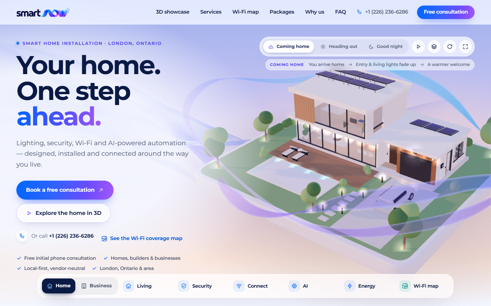
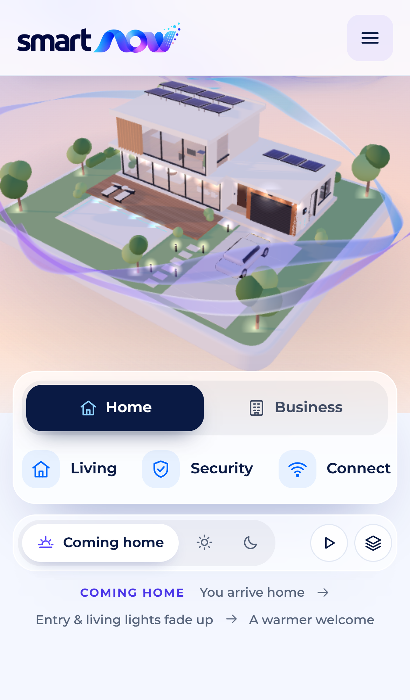
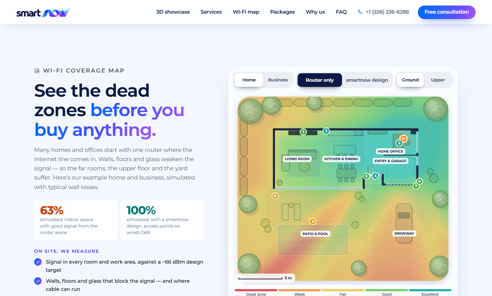

## Adam Sari

**I turn business problems into working AI-built systems: discovery, solution design, delivery.**

London, Ontario · Canadian PR · open to relocation

- **Exara** · Founder/CTO (Jul 2025 to present). A three-person AI studio in Dubai ([exara.ae](https://exara.ae)) building products and client systems.
- **Kenchi.AI** · Product Engineer, AI Platforms (Dec 2025 to Sep 2026). 3D massing editor with image-to-3D refinement, floor-plan editing with DXF import/export, and the Stripe + Supabase subscriptions behind the paid rollout.

### Selected work

#### [smart-now.ca](https://smart-now.ca) · website for a smart-home and networking installer in London, ON

**Problem:** Wi-Fi coverage, security and automation are hard to picture before an installer visits, so homeowners struggle to judge what they need.

**What I designed:** a site that shows the product instead of describing it, then turns interest into a consultation request.

- Interactive three.js model of a home and a business, with scenes for lighting, security, Wi-Fi and energy
- Multi-wall Wi-Fi coverage simulator: router-only versus a designed access-point layout
- Plan builder that turns property size, floors and priorities into access-point, Cat6 and PoE counts
- Lead capture into the client's Wix backend; technical SEO (JSON-LD, sitemap, canonical URLs)
- 3D bundle cut from about 2 MB to 155 KB gzipped

  
  

#### [pitrush.ae](https://pitrush.ae) · car-service RFQ marketplace (UAE)

Drivers post a service request and get quotes from garages. Live, built with a teammate at Exara.

#### Used-car diagnostics · pre-purchase risk reports

A deterministic rule engine (101 rules, 147 test fixtures) makes the diagnosis; the LLM (Gemini) only writes the explanation. CI gates include `mypy --strict` and an accuracy evaluation. Private repo, demo on request.

#### Retail refill tool (Exara client)

Turned an ops team's sell-through rules, warehouse limits and redistribution logic into a tested engine, API and guided UI. A roughly three-week manual process became a calculation that runs in seconds.

#### Open source

| Project | What it does |
|---|---|
| [feasible](https://github.com/adam-sari/feasible) | Turns written operating rules into constraints, solves them with OR-Tools CP-SAT, verifies the result independently with Z3, and issues signed certificates. |
| [stock-tracker](https://github.com/adam-sari/stock-tracker) | Local-first market-intelligence app: 20+ signal sources (SEC EDGAR, insider and congressional trades) feeding a composite score. Next.js + SQLite, 271 tests. |

### How I work

1. **Discovery first.** Sit with the people doing the work and write down the rules they actually use.
2. **Written specs.** Agree on a spec before building. For example, a 115-page implementation blueprint for an Amazon-to-Zoho reconciliation system.
3. **Verification gates.** Deterministic logic where correctness matters, LLMs where language helps, and tests or evaluations that fail the build.

**Stack:** TypeScript, React, Next.js, Astro · Python · Postgres, Supabase, PostGIS · SwiftUI · OR-Tools, Z3 · Gemini API

B.Sc. Artificial Intelligence and Computer Science, University of Birmingham (2025) · OCI Generative AI Professional (2025) · English and Arabic

### Contact

[adamsari20005@gmail.com](mailto:adamsari20005@gmail.com) · [LinkedIn](https://www.linkedin.com/in/adamsari/)
